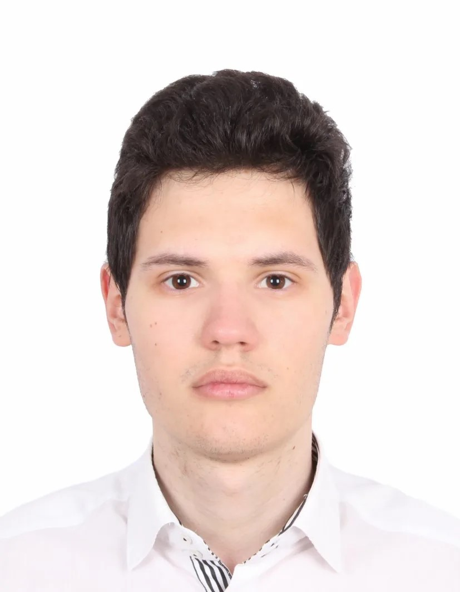

Здравствуйте!

Меня зовут Герман, я начинающий программист на Python. Желаю начать разработку десктопного ПО для платформ Windows/MacOS в направлении работы со звуком и автоматизацией процессов в звукорежиссерской работе.

На данный момент я совмещаю работу и обучение, но уверен, в ближайшее время я добьюсь больших успехов.

Моя фотография :)

